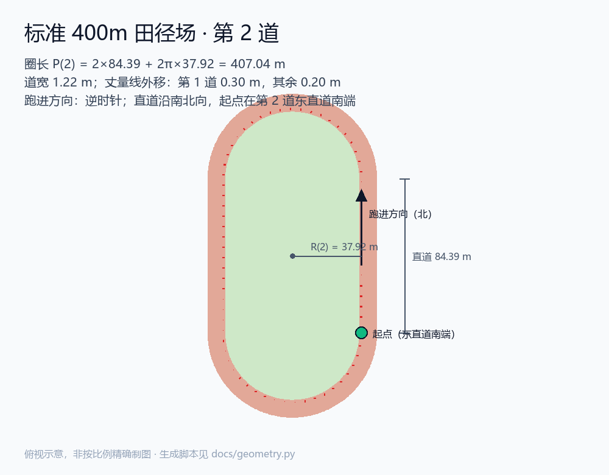

# track400

沿标准 400m 田径场跑道连续绕圈，通过 **USB + 开发者调试通道**（usbmuxd → RSD 隧道 → DVT → `simulateLocation`）把 iPhone 的位置注入为跑道上的坐标；配速可指定，停止后立即恢复真实定位。

> **边界**：只用 Apple 公开的开发者调试通道，不越狱、不做任何检测对抗、不伪装传感器/步频/IP、不针对任何第三方 App 的风控做绕过。位置注入是**内存级**的：进程退出、`clear`、重启都会恢复真实定位。

> **第一次用请先看 [使用教程](docs/tutorial.md)**：从装环境、5 项前置检查，到真机 60 秒试跑和正式 5 km，含排错。



---

## 1. 坐标（先看这一节）

用户提供的操场中心是百度地图读数（BD09）：`lat=34.04244774, lon=108.77577825`。

标准两级反纠偏（BD09 → GCJ02 → WGS84）结果：

```
BD09   (34.04244774, 108.77577825)
GCJ02  (34.03672850, 108.76920629)
WGS84  (34.03824080, 108.76449900)   ← 送进 simulateLocation 的值
```

> ⚠️ 曾经流传过一个“转换后 ≈ 34.035203 / 108.773109”的结果，它与标准链相差 **864 m**，落点在跑道西北的农田里（卫星影像核对图 [`docs/track400_compare.png`](docs/track400_compare.png)）。本项目一律使用上面的 WGS84 结果；`--lat/--lon` 可覆盖。

算法常数出处见 `src/track400/geo/datum.py` 模块 docstring（Krasovsky 1940 椭球、GCJ-02 偏移多项式、BD09 极坐标修正、迭代求逆收敛判据）。

---

## 2. 安装

要求：Windows 10/11（macOS/Linux 未验证）、Python ≥ 3.10、iPhone 已用 USB 连接。

```powershell
cd track400
python -m pip install -e .
python -m pytest            # 82 passed
track400 --version          # track400 1.1.0
```

真机模式额外需要 `pymobiledevice3==11.36.0`（`pip install -e ".[device]"` 已包含）。

---

## 3. 快速开始

**一键启动（推荐）**：双击 `start.bat`，或命令行直接跑：

```powershell
track400
```

默认配置 = **5 km @ 3'10"/km**（950 s ≈ 15 分 50 秒，第 2 道 12.28 圈）。

**无设备干跑（400 倍速，3 秒看完）**

```powershell
track400 --fake --speedup 400
```

**其它常用**

```powershell
track400 --pace 3:10 --distance 5km            # 显式写全（等价于默认）
track400 --distance 10km                       # 改距离
track400 --laps 12                             # 按圈数跑
track400 --bd09 34.04244774,108.77577825       # 直接给百度坐标
track400 --heading 90                          # 跑道旋转 90°（直道变东西向）
track400 --gpx-out runs/route.gpx              # 额外产出 GPX（可喂 simulate-location play）
```

---

## 4. 参数

| 参数 | 默认 | 说明 |
|---|---|---|
| `--lat/--lon` | 内置中心 | 操场中心（WGS-84） |
| `--bd09 LAT,LON` | — | 操场中心（BD09），内部反纠偏 |
| `--pace` | `3:10` | 配速，`3:10` 或 `190`（秒/公里） |
| `--lane` | `2` | 道次 1..8 |
| `--distance` | **5km** | 总距离，支持 `5km` / `5000m` / `5000` |
| `--laps` / `--duration` | — | 可选替代目标：圈数 / 总时长（与 `--distance` 三选一） |
| `--heading` | `0` | 起跑朝向（度，自北顺时针）；整条跑道绕中心旋转 |
| `--dt` | `1.0` | 采样间隔，限 `[0.5, 1.0]` 秒 |
| `--fake` | 关 | 不接手机，坐标流落 JSONL |
| `--out` | `runs/fake_<ts>.jsonl` | FakeDevice 输出路径 |
| `--udid` | 第一台 USB 设备 | 目标设备 |
| `--resume-after-reconnect` | 关 | 断线重连后自动续跑；默认停下等你按 `r` |
| `--keepalive` | `10` | 暂停期间重发最后一点的间隔（秒） |
| `--gpx-out` | — | 同时写 GPX |
| `--speedup` | `1.0` | 仅 `--fake` 可用 |
| `--every` | `1.0` | 进度刷新间隔（秒） |
| `--verbose/-v` | `0` | 日志级别（`-v` INFO，`-vv` DEBUG） |

---

## 5. 运行中控制与退出码

| 按键 | 动作 |
|---|---|
| `p` | 暂停（时间轴冻结，保活继续，配速不受影响） |
| `r` | 继续（时间轴重锚） |
| `s` / `q` | 停止（走 `finally` 调 `clear()`） |
| `Ctrl+C` | 同上，退出码 130 |

非交互终端（管道/CI）里只有 `Ctrl+C` 可用，程序会明确提示。

退出码：`0` 跑完 / `1` 运行错误（带错误码与建议）/ `2` 参数错误 / `130` 用户中断。

---

## 6. 真机前置条件

1. **Apple 驱动**：`Apple Mobile Device Service` 正在运行，设备管理器里 `Apple Mobile Device USB Device` 正常。若它是 `Stopped`（本机常见，启动类型为「手动」），双击 `fix-usbmuxd.bat` 修复。
2. **信任此电脑**：`C:\ProgramData\Apple\Lockdown` 下有该机的 pairing record。
3. **开发者模式**：设置 → 隐私与安全性 → 开发者模式 = 开（iOS 17+ 重启后需先解锁一次）。
4. **开发者镜像（DDI）已挂载**：本项目启动时会探测 RSD 服务 `com.apple.instruments.dtservicehub`，缺失才尝试自动挂载。
5. **不要在别的进程里占着隧道**：无 root userspace 隧道是**进程级单例**，同一时刻只能有一条。

---

## 7. 验收手册

### 7.1 无设备（4 项）

```powershell
python -m pytest
# 期望：82 passed

track400 --fake --speedup 400 --every 300
# 期望：951 点、clear 1 次、Δt 恒定、末点 5000 m、用时 15:50

track400 --fake --speedup 400 --gpx-out runs/check.gpx
python tools\verify_gpx.py runs\check.gpx --points 951 --duration 950 --dt 1.0 --distance 5000 --lane 2
# 期望：PASS

python tools\dry_run.py --laps 12
# 期望：圈数 12.000、时长 ≈ 927.9 s
```

| 验收项 | 目标 | 实测 |
|---|---|---|
| 第 2 道一圈 | 407.04 ± 0.5 m | 407.0384 m |
| 5 km 平均速度 | 5.2632 ± 0.05 m/s | 5.263158 m/s |
| 闭合误差 | < 1 m | 0.0 m（单圈首末点） |
| 时间戳 | 严格递增、Δt=1.0 | 951 点、Δt 恒 1.000 |
| stop 后 | 必调 clear | JSONL 中 `clear` = 1 |

### 7.2 真机（3 项）

**(a) 覆盖真实性（1 分钟）**

```powershell
python tools\live_test.py --seconds 60 --pace 9:00
```

同时打开手机「地图」：蓝点应在操场上，沿**东直道向北**移动；Ctrl+C 后回到真实位置。

**(b) 满时长（默认 5 km ≈ 15 分 50 秒）**

```powershell
track400
```

判定：平均配速偏差 < ±3%（日志里 `计划 15:50` + 951 点）；结束时 `clear` 执行。

**(c) 锁屏 + 拔线**

- 跑到 3 分钟时按电源键锁屏 30 s，再解锁：进度应继续、无断点；
- 跑到 6 分钟时拔线 3 s 再插回：应打印 `[lost]` → `[reconnected]`，**等你按 `r`** 后从断点续跑；
- 加 `--resume-after-reconnect` 可跳过等待（不推荐用于验收）。

---

## 8. 架构

```
geo/     BD09→GCJ02→WGS84、局部 ENU          （纯函数）
track/   400m 几何、等间距采样                  （纯函数）
pacing/  配速 → 时间戳、圈数/剩余                （纯函数）
gpx      GPX 1.1 写 + 契约校验                  （标准库）
device/  IDevice ⇐ FakeDevice / RealDevice     （真机层才 import pymobiledevice3）
controller 状态机、绝对时间轴、保活、重连、Ctrl+C
cli/     argparse + 键盘控制
```

**时间轴**：`deadline(k) = anchor + t_k + paused_total`，绝对时刻推进，暂停只平移不压缩配速。

**状态机**：

```
IDLE → RUNNING ⇄ PAUSED → STOPPING → STOPPED（finally 必 clear）
         └── DeviceError → LOST → RECONNECTED →（等你 resume）→ RUNNING
```

---

## 9. 已知限制（未核实项，别当成已支持）

| 项 | 状态 |
|---|---|
| DDI 自动挂载（`auto_mount`） | **未核实**。本机 `raw.githubusercontent.com` 被 hosts 指到 `127.0.0.1`，下载必失败；代码路径保留，失败会给出 3 条修复路径 |
| 锁屏期间是否持续注入 | **未核实**，需按 7.2(c) 实测 |
| 15 分 50 秒（5 km）长连接稳定性 | **未核实**，需按 7.2(b) 实测 |
| 位置是否覆盖真实 GPS | **协议层已核实，视觉待确认** |
| macOS / Linux | 未测试（代码未用平台特有 API，但未验证） |

---

## 10. 第三方与许可

- 本项目以 **GPL-3.0-or-later** 发布，见 [`LICENSE`](LICENSE)。原因是真机路径 import 了同许可证的 `pymobiledevice3`。
- 运行时仅依赖标准库；真机模式依赖 [`pymobiledevice3`](https://github.com/doronz88/pymobiledevice3) **11.36.0**（GPL-3.0-or-later）。
- 卫星影像核对使用 Esri World Imagery（仅用于开发期坐标验证，不随程序分发）。

报错处置见 [`docs/errors.md`](docs/errors.md)。
